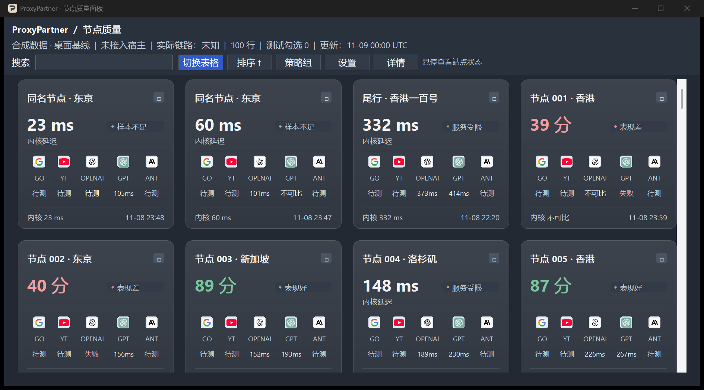

# ProxyPartner Lite

**比较 Clash 节点在常用网站上的表现，再决定切哪条线路。**

[下载 Windows x64 便携版](https://github.com/Pachin1919/ProxyPartner/releases) · [使用说明](README.zh-CN.md#试用-windows-预览版)

同一个节点打开 Google 很快，访问 ChatGPT 也可能超时。ProxyPartner Lite 是一款 Windows 节点测速面板，接入本机 Clash Verge Rev 使用的 Mihomo 内核，把 Google、YouTube、OpenAI API、ChatGPT 和 Anthropic API 的测速结果放在同一个窗口。

- **按网站选节点。** 用卡片查看各站延迟和超时，用表格按评分排序。OpenAI API 和 ChatGPT 分开测。
- **边用边测。** 兼容节点可以在后台独立测速，当前线路照常使用。
- **查看出口 IP。** 两个外部服务分别回报看到的地址，面板显示两处结果是否一致。

Windows 预览版支持中英文、深浅主题，以及 VLESS、Shadowsocks、Trojan 和 VMess 的常见配置。

便携版解压后双击 `ProxyPartner.exe`。内置 C++ 测速组件支持带 TLS 混淆的 ChaCha20-Poly1305 Shadowsocks 节点。
