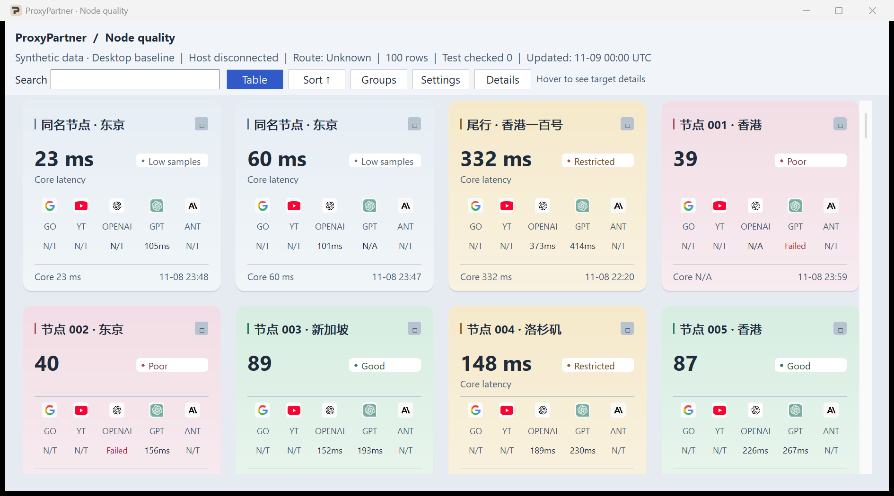

# ProxyPartner Lite

**Find the Clash node that works best for the sites you use.**

Google can respond in milliseconds while ChatGPT times out on the same node. ProxyPartner compares **Google, YouTube, OpenAI API, ChatGPT, and Anthropic API** across your existing nodes in one Windows window.

[Try the Windows preview](#try-the-windows-preview) · [简体中文](README.zh-CN.md) · [Measured results](docs/preview-validation.md)



## What you can do

- **Compare before switching.** See the delay and result for each site. Scan the cards at a glance, or sort the table by score to narrow your choices.
- **Test nodes you aren't using.** ProxyPartner starts a scan of compatible nodes when you open it. The scan runs alongside your current Clash connection.
- **See what went wrong.** The panel distinguishes a timeout, a failed probe, and a node that needs a supported configuration. The quality score combines response rate, delay, and variation across recent samples.
- **Check your exit IP.** Two external services report the address they see. The details panel shows whether they agree and tracks observed changes during the session.
- **Switch when you decide.** Double-click a card or select a row and press **Enter** to switch through a manual Clash policy group. Use Chinese or English in light or dark mode.

A Windows test with a real Shadowsocks subscription finished **41 node probes in 11.46 seconds** and averaged **25.08 MiB of private memory**. All 33 nodes counted as non-current in that run returned a time for each of the five sites. [Test conditions and results](docs/preview-validation.md)

## Try the Windows preview

Build the preview on Windows x64 with the .NET 10 SDK and the Visual Studio **Desktop development with C++** workload. The build produces a self-contained EXE. [Native AOT build requirements](https://learn.microsoft.com/en-us/dotnet/core/deploying/native-aot/#prerequisites)

From the repository root in PowerShell, run the build and open the demo.

```powershell
dotnet publish .\build\DesktopBaseline\DesktopBaseline.csproj -c Release -r win-x64 -o .\runs\preview
Copy-Item .\build\DesktopBaseline\*.LICENSE.txt .\runs\preview
& .\runs\preview\ProxyPartner.exe --demo
```

To see your nodes, start Clash Verge Rev, then open `ProxyPartner.exe` without `--demo`. Use Clash's **System Proxy** to enable current-route verification. The preview has been tested with Mihomo v1.19.21.

To scan other nodes, put a file named `ProbeProfilePath.txt` beside the EXE. Give it one line containing the absolute path to your active local Clash configuration. Leave the subscription in Clash. ProxyPartner uses the local file to get the dial settings for each compatible node.

## Independent probe compatibility

| Node type | Configuration coverage |
| --- | --- |
| VLESS | Supported TLS and REALITY configurations. |
| Shadowsocks | AEAD over TCP, including the `obfs` plugin in TLS mode. |
| Trojan | TCP with TLS and WebSocket with TLS. |
| VMess AEAD | `alterId=0` with TCP, WebSocket, or WebSocket with TLS. |

The preview measures HTTP response time and reachability for API endpoints. Running a model requires separate credentials and a separate check. Measurements and exit-IP observations stay in memory for the current session.

[Compatibility test details](docs/preview-validation.md) · [Project design](spec/DESIGN.zh-CN.md) · [MIT license](LICENSE)
