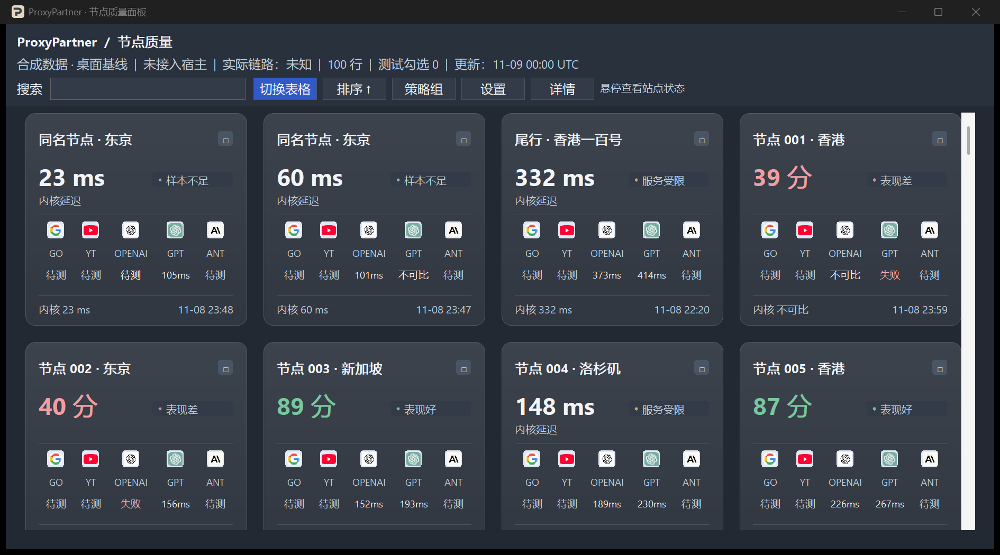

# ProxyPartner Lite

**看清哪个 Clash 节点更适合你常用的网站。**

同一个节点打开 Google 很快，访问 ChatGPT 也可能超时。ProxyPartner 把现有节点访问 **Google、YouTube、OpenAI API、ChatGPT 和 Anthropic API** 的结果放进一个 Windows 窗口，方便直接比较。

[试用 Windows 预览版](#试用-windows-预览版) · [English](README.md) · [查看实测](docs/preview-validation.md)



## 用它做什么

- **先比较，再切节点。** 卡片用来扫一眼各站点表现，表格可以按评分排序。OpenAI API 和 ChatGPT 分开显示，方便按自己的用途选线路。
- **当前连接继续用，其他节点同时测。** 打开窗口就开始扫描兼容节点。测速独立运行，Clash 的策略组选点由你决定。
- **看懂慢在哪里。** 每站分别显示耗时、超时和探测失败。节点缺少配置或组合不兼容时，面板会说明原因。综合分结合近期的响应率、延迟和波动。
- **看出口 IP 有没有变。** 两个外部服务分别回报看到的地址。详情显示结果是否一致，并记录本次会话中观测到的变化。
- **按习惯查看。** 界面支持中英文和浅色、深色主题。

## 试用 Windows 预览版

在 Windows x64 安装 .NET 10 SDK，并在 Visual Studio 或 Build Tools 中安装 **使用 C++ 的桌面开发**工作负载。构建会生成可以独立运行的 EXE。 [Native AOT 构建要求](https://learn.microsoft.com/en-us/dotnet/core/deploying/native-aot/#prerequisites)

在仓库根目录打开 PowerShell，构建并打开演示。

```powershell
dotnet publish .\build\DesktopBaseline\DesktopBaseline.csproj -c Release -r win-x64 -o .\runs\preview
Copy-Item .\build\DesktopBaseline\*.LICENSE.txt .\runs\preview
& .\runs\preview\ProxyPartner.exe --demo
```

要看自己的节点，先启动 Clash Verge Rev，再双击 `ProxyPartner.exe`。需要核实当前线路时，在 Clash 开启**系统代理**。预览版已在 Mihomo v1.19.21 上实测。

要测其他节点，在 EXE 同目录创建 `ProbeProfilePath.txt`，写入一行当前生效的本地 Clash 配置文件绝对路径。订阅继续由 Clash 管理，ProxyPartner 从本地配置读取兼容节点的拨号参数。

## 独立测速兼容范围

| 节点类型 | 支持的配置 |
| --- | --- |
| VLESS | 兼容的 TLS 和 REALITY 配置。 |
| Shadowsocks | AEAD TCP，含 `obfs` 插件的 TLS 模式。 |
| Trojan | TCP + TLS、WebSocket + TLS。 |
| VMess AEAD | `alterId=0`，支持 TCP、WebSocket、WebSocket + TLS。 |

API 测量反映 HTTP 可达性和响应耗时。模型调用需要另行提供凭证并验证。测速和出口 IP 记录保留在当前运行会话。

[兼容性测试详情](docs/preview-validation.md) · [项目设计](spec/DESIGN.zh-CN.md) · [MIT 许可证](LICENSE)
