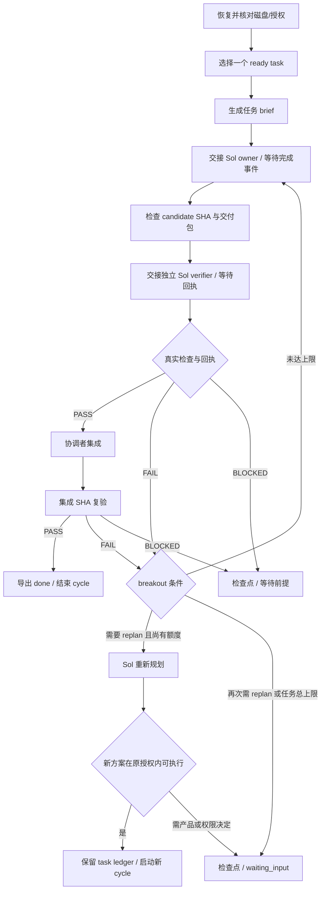

# LangGraph 开发执行器设计

2026-11-06：设计已落盘，执行器尚未实现/安装/运行。此文不构成 LangGraph 已接通 Codex 的声明。用户选择 gpt-6.1-sol 主导，不使用 Astra 自动升级。

## 最小实现边界
Python LangGraph 本地进程，仅处理本仓库开发循环；不需要 LangSmith、服务端、云部署、LangChain agent 或新的模型 API Key。模型执行复用当前已登录的 Codex 能力，但外部 Python 不会自动获得聊天工具：必须单独实现并实测 dispatch adapter。

先采用文件交接 adapter：图生成 brief 并 interrupt，Sol 主会话启动/管理实现与验收会话，将结构化完成事件回送同一图运行。之后如有必要再接当前 Codex 支持的 CLI/app-server；本轮不假定命令行参数或订阅身份可直接用于模型 API。

未来代码仅放 tools/orchestrator/，最小内容为 graph.py、适配交接入口、锁定依赖、行为测试与 README。不先建设通用 agent 平台。Python 与 LangGraph/checkpoint-sqlite 需在可用解释器上锁精确版本和依赖；目前尚未锁定，不提供未经运行的安装成功声明。

## 数据所有权
- tasks.json：产品依赖和 required_checks 的唯一主表，沿用 T00–T11，不复制进图代码。
- 派工时按模块归属选候选 owner 和补丁接收方。跨模块补丁随主责组装的候选进入产品验收。 [模块归属表](module-ownership.json) [统筹交接](handoff/README.md)
- LangGraph checkpointer：当前 cycle 的调度状态，使用本地 SQLite，按 repo/task/cycle/run 确定 thread_id；SQLite checkpoint 数据库与产品数据库完全分开。
- state.json：协调者导出的任务状态投影，保持现有 Go 工具的严格 schema。只有调度器/协调者一个写入者，worker 不写。
- receipt + 原始 evidence：验收事实。checkpoint 有 PASS 字样不等于通过；tools/flow check 对实际 SHA 和文件做一致性核对，verifier 对真实执行负责。

只把 task ID、base/candidate/integration SHA、session/worktree 标识、brief/receipt 路径及 hash、失败计数、failure signature、next action 和 interrupt 原因放进图状态。另持久保存 task 级 ledger，累计跨 cycle 的根因修复、replan 和候选/集成验证轮数；新 cycle 不抹除任务上限。不存订阅、密钥、原始会话长文本或节点配置。

## 节点与路由

每个 cycle 只覆盖一个产品任务及有限返工；成功后 Sol 在当前授权会话中启动下一个 ready cycle。所有节点进入前检查停止和所有权；验证/replan 限额在下一次派工前检查，不阻止最后一轮已通过的结果落地。scope、证据和状态校验在确定性代码中执行，不交给模型凭文字决定。

dispatch 与 wait 分开：先记录唯一 dispatch ID 和意图；主会话按此 ID 发起一次，回送 session ID。恢复若有意图但没有结果，先向主会话查询是否已启动；状态不明就 interrupt 等待核对，不自动重发。解决的是开发中断后重复开工/重放集成这一具体问题，不追求分布式 exactly-once 平台。

## 中断与恢复
使用持久 checkpointer 和稳定 thread_id；用 interrupt/Command(resume=...) 传递交接及必要用户输入。interrupt 所在节点恢复时可能从头执行，所以副作用放在独立节点，按 dispatch ID/实际 Git 状态核对后再推进。不在包围 interrupt 的通用 try/catch 中吞掉暂停信号。

运行前核对实际 HEAD、worktree、已有 session、证据 hash 和 workflow 版本。恢复已有 cycle 不重新传初始输入覆盖状态；改变了图状态契约时先显式迁移或开新 cycle 并保留关联。

checkpointer 成功而 state.json 导出失败：恢复时根据 checkpoint 和有效 receipt 重新投影；state 已 done 而 receipt 无效：退回 reconcile，不沿用完成结论。对有副作用节点不配置盲目 RetryPolicy；breakout 规则优先于技术步数上限。

## 执行器启动关口（产品 T00 之前，单独报告）
| 检查 ID | 实现验收场景 |
|---|---|
| runtime-lock | 可用 Python、锁定 LangGraph 与 SQLite checkpointer 版本；新环境按锁复现，无模型调用 |
| graph-routing | 假 adapter 下 PASS 进入集成复验；FAIL 退回 owner；BLOCKED 不启动依赖任务 |
| repair-breakout | 初次失败 + 两次同因修复失败进入 replan；6候选/cycle、一次自主replan/task、12验证轮/task 的跨 cycle 上限和无 ready 未完成场景正确退出 |
| persistent-resume | 真实子进程退出后重开，SQLite 恢复同一 thread/cycle 和失败计数，而非内存 saver 演示 |
| dispatch-reconcile | 在发工前后及集成前后中断，不重复启动、不重复提交；不确定结果等待核对 |
| sha-evidence-gate | 旧 SHA、自验、证据缺失/变更、缺检查均不能进入 done；集成新 SHA 必须复验 |
| state-projection | checkpoint/state 导出中断后可核对恢复；单写入；不会把未知状态变成通过 |
| sol-model-policy | 实际 model 与策略一致；无 Astra/fallback；未授权远程操作不执行 |

先假 adapter 跑全路由且无模型成本；再做一个有明确范围的 Sol 交接实测，验证输入/回执/恢复。上述全部通过前标 WORKFLOW_NOT_READY，不声称已有自动化执行器；资料包的 flow validate 不能替代这些检查。

## 官方依据与本项目取舍
查阅日期 2026-11-06。LangGraph 的图状态/节点/条件边用于映射本项目的交接与返工；持久化和 interrupt 用于保存并恢复状态。这些能力不证明任务执行真实成功，也不会自动提供 Codex adapter。
- [LangGraph overview](https://docs.langchain.com/oss/python/langgraph/overview)
- [Graph API](https://docs.langchain.com/oss/python/langgraph/graph-api)
- [Persistence](https://docs.langchain.com/oss/python/langgraph/persistence)
- [Interrupts](https://docs.langchain.com/oss/python/langgraph/interrupts)
- [Codex subagents](https://learn.chatgpt.com/docs/agent-configuration/subagents)：项目代理可设置 model；使用前仍需验证当前宿主实际加载。
